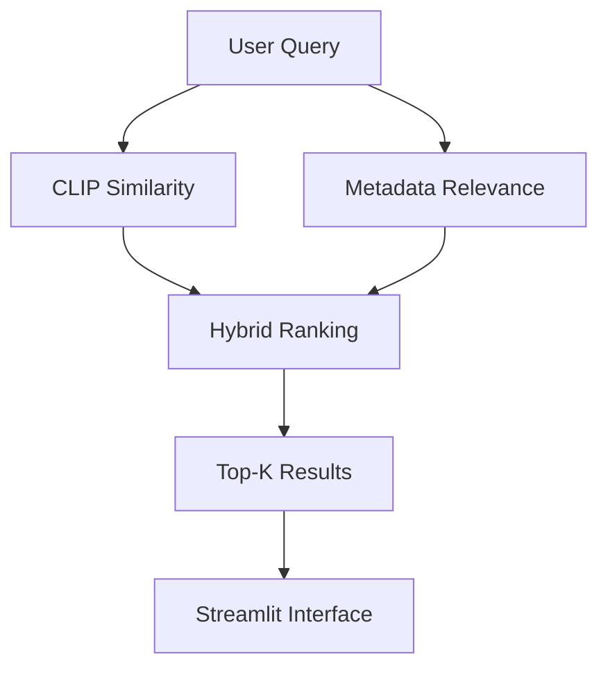

# Jeju DataHub — AI-Powered Report Search

### CLIP-Based Hybrid Information Retrieval System

An interactive search application for Jeju consumption
trend reports, combining visual embeddings with
domain-specific metadata retrieval.


## 1. Project Overview

This project was developed as part of a Management
Information Systems course at Jeju National University.

It aims to improve information retrieval across monthly
Jeju consumption trend reports through an AI-powered
hybrid search system.

## 2. Problem Statement

As monthly reports accumulate, manually locating
relevant charts and information becomes increasingly
time-consuming.

Conventional document search may also struggle with
visual information, charts, and domain-specific queries.

This project explores a hybrid retrieval approach
that combines visual similarity and metadata relevance.

## 3. Dataset

- Source: Jeju DataHub consumption trend reports
- Period: January–September 2026
- Format: PDF reports and extracted page images
- Domain: Credit card spending and consumption trends

The original reports and derived materials remain
subject to their respective usage and redistribution terms.

## 4. System Architecture



The system combines two retrieval components:

- CLIP-based image-text similarity
- Korean domain-specific metadata matching

The default hybrid scoring function is:

Hybrid Score = 0.65 × Metadata Score + 0.35 × CLIP Score

## 5. Key Features

- Korean-language report search
- CLIP-based visual information retrieval
- Domain-specific metadata matching
- Hybrid relevance ranking
- Date and category filtering
- Report page previews
- Search score visualization
- Query interpretation
- Original PDF access
- Responsive web interface

## 6. Technology Stack

| Technology | Purpose |
|---|---|
| Python | Application development |
| PyTorch | Model and embedding processing |
| CLIP ViT-B/32 | Image-text similarity |
| Hugging Face Transformers | Pretrained model integration |
| Streamlit | Interactive web interface |
| GitHub | Version control and documentation |

## 7. Performance Evaluation

A preliminary benchmark was conducted using six
domain-specific Korean search queries.

CLIP-only retrieval was compared with hybrid retrieval
using Hit@5 and Precision@5.

### Benchmark Results

| Metric | CLIP Only | Hybrid Search |
|---|---:|---:|
| Strict Hit@5 | 50.0% | 100.0% |
| Relaxed Hit@5 | 66.7% | 100.0% |
| Mean Strict Precision@5 | 13.3% | 93.3% |

The hybrid approach achieved better retrieval
performance on this benchmark.

However, these results are limited to six predefined
queries and rule-based relevance criteria.
They should not be interpreted as evidence of
generalizable retrieval performance.

Detailed results:
[benchmark_results.json](benchmark_results.json)

Evaluation script:
[run_benchmark.py](run_benchmark.py)

## 8. Repository Structure

```
jeju-datahub-clip/
├── data/
├── scripts/
├── app.py
├── benchmark_results.json
├── requirements.txt
└── run_benchmark.py
```

## 9. Getting Started

Install the required dependencies:

```bash
pip install -r requirements.txt
```

Run the Streamlit application:

```bash
streamlit run app.py
```

Run the benchmark:

```bash
python run_benchmark.py
```

The required report data, pretrained model, and
embedding index must be available.

## 10. My Role

- Problem identification and requirements definition
- AI-assisted system design and implementation
- Search feature planning
- User interface review
- Retrieval performance evaluation
- Project documentation

## 11. AI-Assisted Development

Generative AI was used to assist with implementation,
debugging, and technical documentation.

This project represents an applied learning experience
in AI-powered information systems and
retrieval performance evaluation.

## 12. Limitations

- Small benchmark query set
- Domain-specific relevance criteria
- Limited evidence of generalizability
- Potential limitations of CLIP for Korean queries
- Incomplete text metadata for scanned documents

## 13. Future Work

- Expand the benchmark query set
- Conduct independent relevance assessments
- Explore multilingual embedding models
- Improve scanned-document processing
- Investigate Retrieval-Augmented Generation (RAG)
- Evaluate user experience and search efficiency

## 14. Author

**Yuji Lee**

Integrated Master's–Ph.D. Student
in Management Information Systems

Jeju National University, South Korea

[GitHub Profile](https://github.com/yujilee-research)

---

*Connecting AI, information systems, and real-world problems.*
